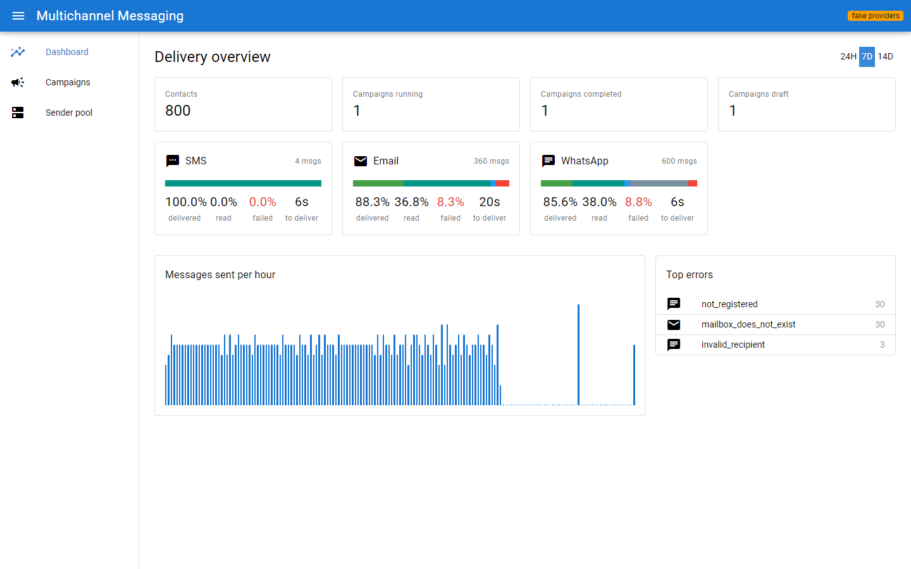
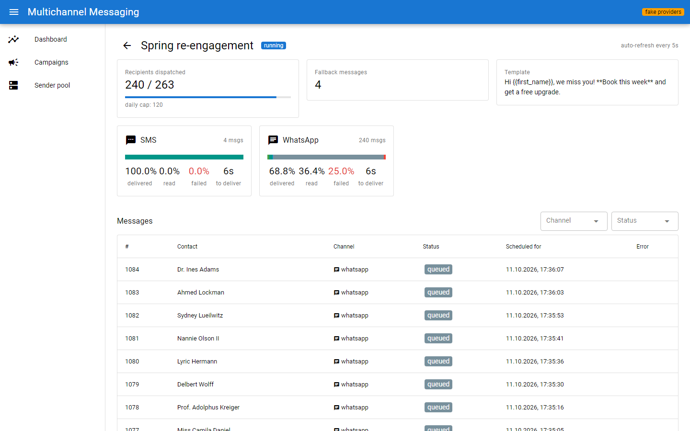
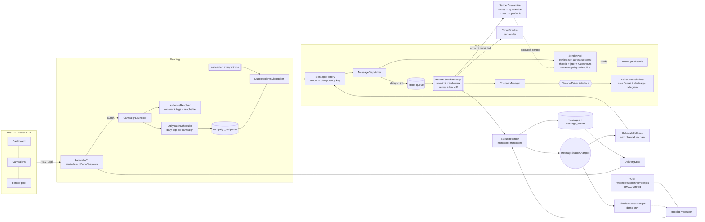
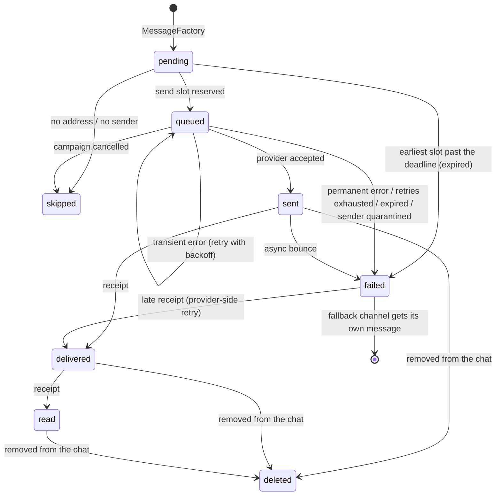
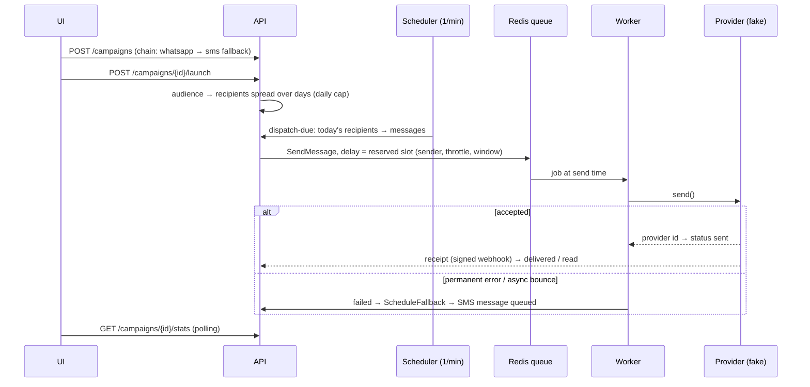
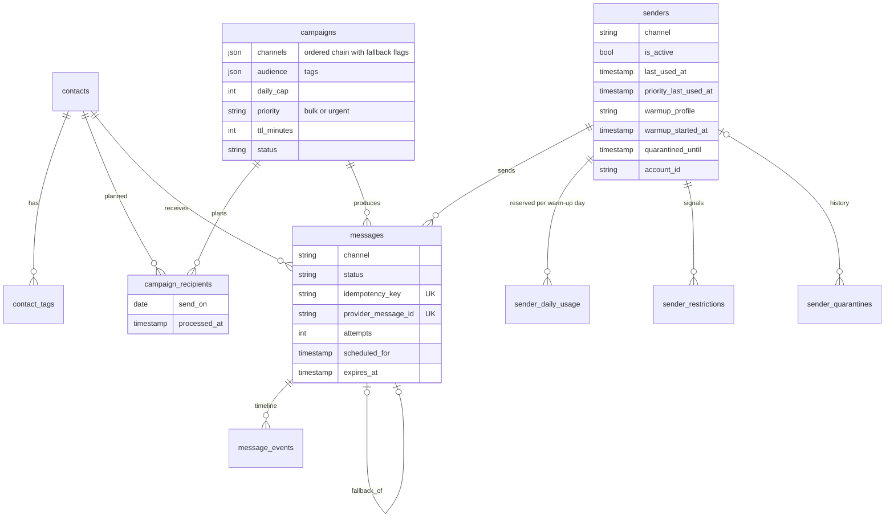

# Multichannel Messaging

Bulk messaging engine for SMS, email, WhatsApp and Telegram built on Laravel queues: pluggable channel drivers, per-sender pacing, sender warm-up and quarantine, message deadlines, daily caps, retries, channel fallback and delivery analytics. It ships with a Vue 3 / Quasar dashboard.

> Every provider is simulated. The channel drivers are fakes that behave like real providers (accept, time out, reject, send delivery receipts later). Nothing leaves your machine, and all data is synthetic.

[](https://github.com/maxakagaret/multichannel-messaging/actions/workflows/ci.yml)    

## Screenshots



*Delivery overview: per-channel funnel (delivered / read / failed, time to deliver), hourly throughput, top errors.*



*A running campaign: recipients spread over days by the daily cap, SMS fallback messages, live message statuses.*

## What it demonstrates

| Problem | Solution in this repo |
|---|---|
| A burst of identical messages gets a number banned | `DailyBatchScheduler` spreads the audience over days (daily cap per campaign); `SenderPool` gives every message a concrete send slot: least recently used sender, throttle and random jitter, inside a local-time sending window |
| Provider errors | Transient errors are rethrown and the queue retries with backoff. Permanent errors fail the message at once. Rate-limit releases don't consume the retry budget (`maxExceptions` + `retryUntil`) |
| A channel doesn't reach the person | Ordered channel chain with fallbacks, e.g. WhatsApp → SMS. Triggered by a sync failure, exhausted retries or an async "undelivered" receipt |
| Double sends after crashes or re-runs | Idempotency key per (campaign, contact, channel); a minutely dispatcher that **always** marks picked recipients as processed |
| A new number sends at full speed and gets banned | **Warm-up profiles** per sender: each warm-up day (24 h from the warm-up start, not the calendar date) has a daily limit and a pace multiplier; silent days allow no sends at all. Part of the daily limit is **reserved for urgent** campaigns, so a bulk send can't take every place before a service notice arrives |
| A late message is worse than none | **Deadlines** (`ttl_minutes`): if the earliest slot is past the deadline, the message fails as `expired` at planning time and falls back to the next channel right away. The send job refuses expired messages whatever queued them. Deadline-bound messages ignore the warm-up limit and pace (moving "tomorrow at 10:00" to tomorrow makes it wrong) and have their own pace pointer, so they don't wait behind a bulk tail |
| The messenger restricts an account | **Quarantine**: a series of "account restricted" answers (bursts from parallel workers count as one) takes the sender out of rotation for 48 h. Its queued messages fall back to the next channel instead of jumping to another number; afterwards it warms up again, starting with silent days. History is kept per account: a repeat quarantine means "replace the number" |
| A provider outage stalls every worker | Per-sender **circuit breaker**: after 3 connection timeouts in a minute, calls for that sender fail fast for a minute instead of hanging on the connect timeout |
| Linking an account without handling its secrets | **One-time link token**: hashed at rest, valid 15 minutes, a new one cancels the old, burned under a row lock on first use. Credentials go straight to the driver and are marked `#[\SensitiveParameter]`. Re-linking the same account keeps its warm-up, a new account starts from day one |
| Receipts arrive out of order | Monotonic status machine: a late "sent" never overwrites "delivered"; a message deleted from the chat stays `deleted` |
| The messages table grows forever | `messaging:prune`: a retention window that walks the primary key in small batches, keeps unsent messages and stops at the first batch without old rows |
| Public webhooks | HMAC-SHA256 signatures, constant-time comparison, unknown ids acknowledged so the provider stops retrying |
| What actually happened? | Append-only `message_events` timeline per message; per-channel funnel with delivery, read and failure rates and time to deliver |

## Architecture



### Message lifecycle



### One campaign, end to end



## Key design decisions

- **Pacing by reservation, not by sleeping.** Every message gets a sender and a send time before it is queued, and the job is dispatched with that delay. Workers never block. A burst of 10 000 messages becomes an evenly spaced schedule across all senders. The sender row is locked (`lockForUpdate`) while its slot is reserved, so parallel dispatchers can't hand out the same slot.
- **Earliest slot across senders.** The pool plans a slot for every available sender and takes the earliest. Without warm-up this is plain least-recently-used rotation; with it, a sender whose warm-up day is full doesn't hold the queue while a warm sender is idle. The planning loop only moves forward (sending window → silent day → daily limit → pace), and profiles are finite, so it settles in a few steps.
- **Warm-up days are relative, usage is keyed by the day's start.** Day N starts at `warmup_started_at + N × 24h`, so an account linked at 23:00 doesn't get day two an hour later. Reservations are counted per `(sender, day_starts_at)`, so a warm-up restarted after a quarantine starts from zero instead of inheriting the old "day 1" counter.
- **Quarantine needs no wake-up job.** Quarantining sets `quarantined_until` and starts the `after_quarantine` warm-up *at* that moment. Until then the pool ignores the sender; afterwards the schedule is simply in effect, beginning with silent days.
- **A message keeps its number.** When a sender is quarantined, its queued messages fail and follow the channel chain (WhatsApp → SMS) rather than move to another WhatsApp number. The recipient knows the conversation by the number it comes from.
- **Deadlines count from creation.** `expires_at` is set when the content is rendered, and a fallback message inherits it: an SMS for a stale reminder is just as stale.
- **Two layers of rate limiting.** Reservation sets the pace. On top of it, a per-sender `RateLimited` job middleware is a hard ceiling in case something bypasses the pool.
- **Drivers are tiny.** `ChannelDriver::send()` maps one provider call to one of three outcomes: receipt, `TransientDeliveryException` or `PermanentDeliveryException`. The job owns retries, the recorder owns statuses, the listeners own the fallback. A real provider is one class plus `ChannelManager::extend()`.
- **Single writer for statuses.** `StatusRecorder` locks the row, checks `MessageStatus::canTransitionTo()`, stamps the timestamp, appends an event and fires `MessageStatusChanged` after commit.
- **The dispatcher invariant.** Every recipient selected by the minutely job is marked processed in `finally`, even if rendering throws or the contact has no address. A minutely cron that re-selects broken rows would retry them forever.
- **Fallback is event-driven.** It reacts to *any* failure path: sync rejection, exhausted retries or an async bounce. Thanks to the idempotency key, a duplicate failure event can't create a second fallback.
- **Portable SQL.** Tags live in a `contact_tags` table instead of a JSON column, so audience filters are indexable and run the same on MySQL (runtime) and SQLite (tests).

## Data model



## API

| Method | Endpoint | Purpose |
|---|---|---|
| GET | `/api/stats/overview?hours=24` | Funnel per channel, hourly throughput, top errors |
| GET/POST | `/api/campaigns` | List / create a draft (validated channel chain) |
| GET | `/api/campaigns/{id}` | Campaign details |
| POST | `/api/campaigns/{id}/launch` | Plan the audience over days |
| POST | `/api/campaigns/{id}/cancel` | Drop unplanned recipients, skip queued messages |
| GET | `/api/campaigns/{id}/stats` | Funnel for one campaign |
| GET | `/api/campaigns/{id}/messages?status=&channel=` | Paginated messages |
| GET | `/api/messages/{id}` | Message with its event timeline |
| GET/PATCH | `/api/senders`, `/api/senders/{id}` | Sender pool with warm-up day, daily usage and quarantine; enable or disable a sender |
| POST | `/api/senders/{id}/link-token` | One-time token (15 min) for linking a provider account |
| POST | `/api/senders/link/{token}` | Upload the account credentials with the token (`{"credentials": {...}}`), throttled |
| DELETE | `/api/senders/{id}/link` | Unlink the account (its warm-up is kept for when it comes back) |
| GET | `/api/contacts`, `/api/contacts/tags` | Synthetic audience |
| POST | `/api/webhooks/{channel}/receipts` | Provider receipts (`delivered`, `read`, `failed`, `deleted`), needs the `X-Signature: hmac_sha256(body)` header |

## Running it

```bash
docker compose up -d --build
```

| Service | URL / role |
|---|---|
| frontend | http://localhost:5173 (Vite dev server, proxies `/api`) |
| nginx + app | http://localhost:8080/api (PHP 8.4 FPM) |
| worker | `queue:work redis --queue=messaging,default` |
| scheduler | `schedule:work`, runs `messaging:dispatch-due` every minute and `messaging:prune` nightly when `MESSAGING_PRUNE_ENABLED=true` |
| mysql, redis | storage and queue |

On the first start the `app` container installs Composer dependencies, migrates and seeds:
- 800 synthetic contacts with tags;
- a sender pool;
- a finished campaign with a week of delivery history;
- a **running** campaign that you can watch being sent in real time (pacing, retries, receipts, SMS fallback);
- a running **urgent** campaign with a 3-hour deadline ("Visit reminders");
- three WhatsApp lines: one warm, one on day 2 of its warm-up, and one whose account the fake provider reports as restricted (`FAKE_RESTRICTED_SENDERS`). Within a few minutes it goes to quarantine on the Senders page, and its messages fall back to SMS.

The `.env.example` widens the sending window to the whole day, so the demo works at any hour.

## Tests

```bash
docker compose exec app vendor/bin/pest
```

The suite runs on in-memory SQLite with a frozen clock and no jitter. It covers:
- status machine, quiet hours, rendering and escaping, channel chains;
- the daily cap scheduler, audience selection;
- the dispatcher invariant (unreachable contacts, a throwing renderer, idempotent re-runs, completion, cancellation);
- sender rotation and throttling;
- the job's retry, permanent-failure and no-op paths, the fallback created only once;
- signed webhooks (bad signature, out-of-order and unknown receipts, async bounce → fallback, deleted messages);
- warm-up: the limit minus the urgent reserve, relative days, pace, silent days, choosing a sender with capacity;
- deadlines: deadline-bound messages skip the limit and the bulk tail, past-deadline slots reserve nothing and fall back, the job never sends expired messages;
- quarantine: single answers ignored, bursts collapsed, the window, no slots while quarantined, the silent restart, restricted sends → quarantine → fallback;
- the per-sender circuit breaker, one-time link tokens (single use, expiry, replacement, refusals, warm-up kept or restarted), the retention command;
- an end-to-end run on the sync queue, plus the seeded dashboards.

## Project layout

```
backend/app/
  Enums/                 Channel, MessageStatus (transition rules), CampaignStatus
  Messaging/
    Contracts/           ChannelDriver, LinksAccounts
    Drivers/             FakeChannelDriver, FakeOutbox, DTOs
    ChannelManager.php   driver registry, extend() for real providers
    Planning/            AudienceResolver, DailyBatchScheduler, CampaignLauncher, DueRecipientsDispatcher
    Delivery/            SenderPool, SlotRequest, QuietHours, MessageDispatcher, MessageFactory, StatusRecorder, ReceiptProcessor
    Senders/             WarmupSchedule, SenderQuarantine, CircuitBreaker, SenderLinker
    Rendering/           MessageRenderer (variables + per-channel formatting, HTML escaping)
    Stats/               DeliveryStats
  Console/Commands/      DispatchDueMessages, PruneMessages
  Jobs/                  SendMessage, SimulateProviderReceipt
  Listeners/             ScheduleFallback, SimulateFakeReceipts
frontend/src/            api (stateless client) → stores (Pinia) → pages / components
```

## Plugging in a real provider

```php
// AppServiceProvider::boot()
app(ChannelManager::class)->extend('acme-sms', fn (Channel $channel, $app) => new AcmeSmsDriver(
    $app->make(\Illuminate\Http\Client\Factory::class),
    config('services.acme'),
));
```

Then set `MESSAGING_SMS_DRIVER=acme-sms` and point the provider's callbacks to `/api/webhooks/sms/receipts`, signed with `MESSAGING_WEBHOOK_SECRET`.

## How this was built

This is a portfolio project. Its architecture is based on production modules I designed and built single-handedly in a commercial SaaS platform. This repository is a clean-room reimplementation: no proprietary code, names or data.

The implementation was written with AI assistance (Claude Code). I defined the requirements and architecture, made the design decisions and reviewed the result. I'm happy to walk through any part of it.

## Out of scope

- Authentication and multi-tenancy: the API is open in this demo.
- Unsubscribe links: the per-contact consent flag is honoured.
- Media attachments.
