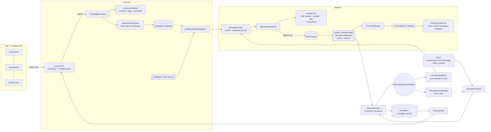
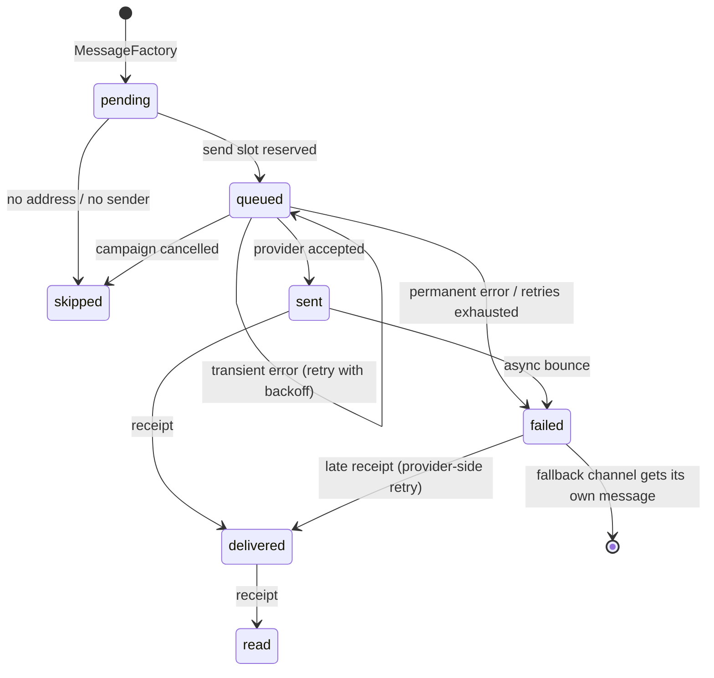
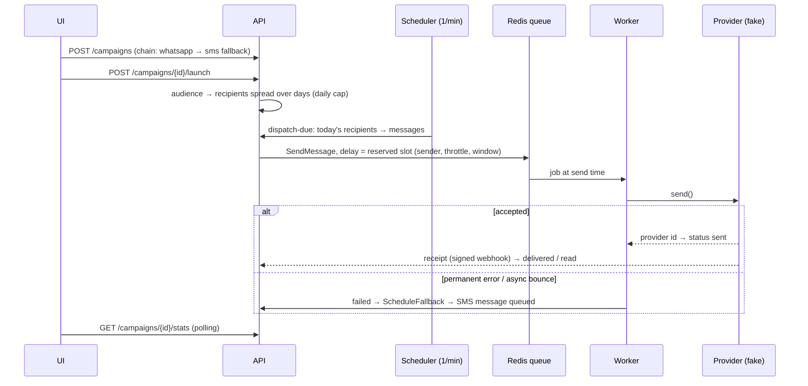
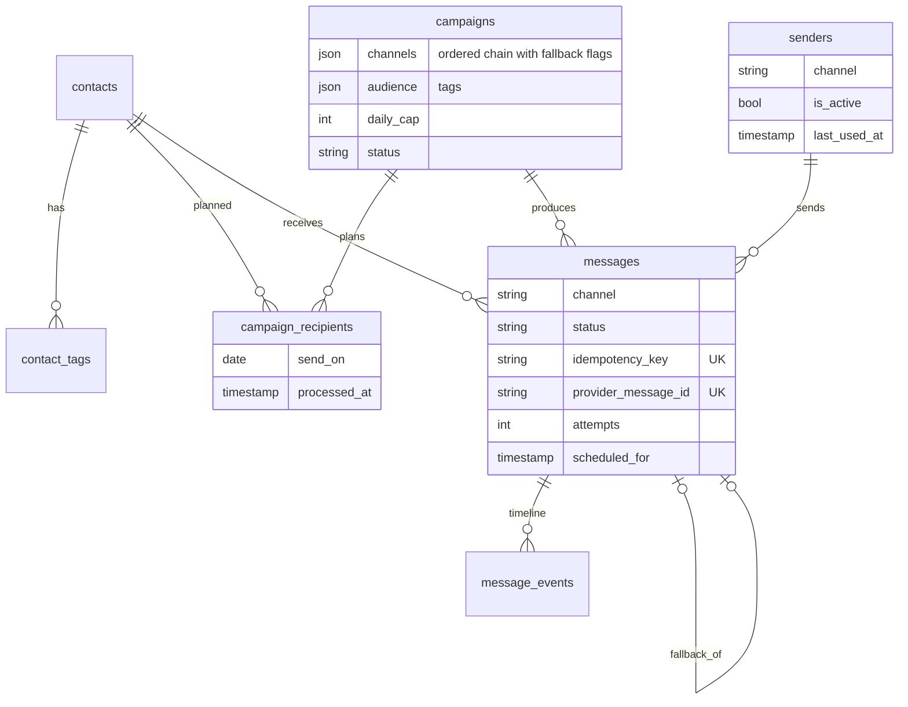

# Multichannel Messaging

Bulk messaging engine for SMS, email, WhatsApp and Telegram built on Laravel queues: pluggable channel drivers, per-sender pacing, daily caps, retries, channel fallback and delivery analytics. It ships with a Vue 3 / Quasar dashboard.

> Every provider is simulated. The channel drivers are fakes that behave like real providers (accept, time out, reject, send delivery receipts later). Nothing leaves your machine, and all data is synthetic.

[](https://github.com/maxakagaret/multichannel-messaging/actions/workflows/ci.yml)    

## What it demonstrates

| Problem | Solution in this repo |
|---|---|
| A burst of identical messages gets a number banned | `DailyBatchScheduler` spreads the audience over days (daily cap per campaign); `SenderPool` gives every message a concrete send slot: least recently used sender, throttle and random jitter, inside a local-time sending window |
| Provider errors | Transient errors are rethrown and the queue retries with backoff. Permanent errors fail the message at once. Rate-limit releases don't consume the retry budget (`maxExceptions` + `retryUntil`) |
| A channel doesn't reach the person | Ordered channel chain with fallbacks, e.g. WhatsApp → SMS. Triggered by a sync failure, exhausted retries or an async "undelivered" receipt |
| Double sends after crashes or re-runs | Idempotency key per (campaign, contact, channel); a minutely dispatcher that **always** marks picked recipients as processed |
| Receipts arrive out of order | Monotonic status machine: a late "sent" never overwrites "delivered" |
| Public webhooks | HMAC-SHA256 signatures, constant-time comparison, unknown ids acknowledged so the provider stops retrying |
| What actually happened? | Append-only `message_events` timeline per message; per-channel funnel with delivery, read and failure rates and time to deliver |

## Architecture



### Message lifecycle



### One campaign, end to end



## Key design decisions

- **Pacing by reservation, not by sleeping.** Every message gets a sender and a send time before it is queued, and the job is dispatched with that delay. Workers never block. A burst of 10 000 messages becomes an evenly spaced schedule across all senders. The sender row is locked (`lockForUpdate`) while its slot is reserved, so parallel dispatchers can't hand out the same slot.
- **Two layers of rate limiting.** Reservation sets the pace. On top of it, a per-sender `RateLimited` job middleware is a hard ceiling in case something bypasses the pool.
- **Drivers are tiny.** `ChannelDriver::send()` maps one provider call to one of three outcomes: receipt, `TransientDeliveryException` or `PermanentDeliveryException`. The job owns retries, the recorder owns statuses, the listeners own the fallback. A real provider is one class plus `ChannelManager::extend()`.
- **Single writer for statuses.** `StatusRecorder` locks the row, checks `MessageStatus::canTransitionTo()`, stamps the timestamp, appends an event and fires `MessageStatusChanged` after commit.
- **The dispatcher invariant.** Every recipient selected by the minutely job is marked processed in `finally`, even if rendering throws or the contact has no address. A minutely cron that re-selects broken rows would retry them forever.
- **Fallback is event-driven.** It reacts to *any* failure path: sync rejection, exhausted retries or an async bounce. Thanks to the idempotency key, a duplicate failure event can't create a second fallback.
- **Portable SQL.** Tags live in a `contact_tags` table instead of a JSON column, so audience filters are indexable and run the same on MySQL (runtime) and SQLite (tests).

## Data model



## API

| Method | Endpoint | Purpose |
|---|---|---|
| GET | `/api/stats/overview?hours=24` | Funnel per channel, hourly throughput, top errors |
| GET/POST | `/api/campaigns` | List / create a draft (validated channel chain) |
| GET | `/api/campaigns/{id}` | Campaign details |
| POST | `/api/campaigns/{id}/launch` | Plan the audience over days |
| POST | `/api/campaigns/{id}/cancel` | Drop unplanned recipients, skip queued messages |
| GET | `/api/campaigns/{id}/stats` | Funnel for one campaign |
| GET | `/api/campaigns/{id}/messages?status=&channel=` | Paginated messages |
| GET | `/api/messages/{id}` | Message with its event timeline |
| GET/PATCH | `/api/senders`, `/api/senders/{id}` | Sender pool, enable or disable a sender |
| GET | `/api/contacts`, `/api/contacts/tags` | Synthetic audience |
| POST | `/api/webhooks/{channel}/receipts` | Provider receipts, needs the `X-Signature: hmac_sha256(body)` header |

## Running it

```bash
docker compose up -d --build
```

| Service | URL / role |
|---|---|
| frontend | http://localhost:5173 (Vite dev server, proxies `/api`) |
| nginx + app | http://localhost:8080/api (PHP 8.4 FPM) |
| worker | `queue:work redis --queue=messaging,default` |
| scheduler | `schedule:work`, runs `messaging:dispatch-due` every minute |
| mysql, redis | storage and queue |

On the first start the `app` container installs Composer dependencies, migrates and seeds:
- 800 synthetic contacts with tags;
- a sender pool;
- a finished campaign with a week of delivery history;
- a **running** campaign that you can watch being sent in real time (pacing, retries, receipts, SMS fallback).

The `.env.example` widens the sending window to the whole day, so the demo works at any hour.

## Tests

```bash
docker compose exec app vendor/bin/pest
```

The suite runs on in-memory SQLite with a frozen clock and no jitter. It covers:
- status machine, quiet hours, rendering and escaping, channel chains;
- the daily cap scheduler, audience selection;
- the dispatcher invariant (unreachable contacts, a throwing renderer, idempotent re-runs, completion, cancellation);
- sender rotation and throttling;
- the job's retry, permanent-failure and no-op paths, the fallback created only once;
- signed webhooks (bad signature, out-of-order and unknown receipts, async bounce → fallback);
- an end-to-end run on the sync queue, plus the seeded dashboards.

## Project layout

```
backend/app/
  Enums/                 Channel, MessageStatus (transition rules), CampaignStatus
  Messaging/
    Contracts/           ChannelDriver
    Drivers/             FakeChannelDriver, FakeOutbox, DTOs
    ChannelManager.php   driver registry, extend() for real providers
    Planning/            AudienceResolver, DailyBatchScheduler, CampaignLauncher, DueRecipientsDispatcher
    Delivery/            SenderPool, QuietHours, MessageDispatcher, MessageFactory, StatusRecorder, ReceiptProcessor
    Rendering/           MessageRenderer (variables + per-channel formatting, HTML escaping)
    Stats/               DeliveryStats
  Jobs/                  SendMessage, SimulateProviderReceipt
  Listeners/             ScheduleFallback, SimulateFakeReceipts
frontend/src/            api (stateless client) → stores (Pinia) → pages / components
```

## Plugging in a real provider

```php
// AppServiceProvider::boot()
app(ChannelManager::class)->extend('acme-sms', fn (Channel $channel, $app) => new AcmeSmsDriver(
    $app->make(\Illuminate\Http\Client\Factory::class),
    config('services.acme'),
));
```

Then set `MESSAGING_SMS_DRIVER=acme-sms` and point the provider's callbacks to `/api/webhooks/sms/receipts`, signed with `MESSAGING_WEBHOOK_SECRET`.

## Out of scope

- Authentication and multi-tenancy: the API is open in this demo.
- Unsubscribe links: the per-contact consent flag is honoured.
- Media attachments.
